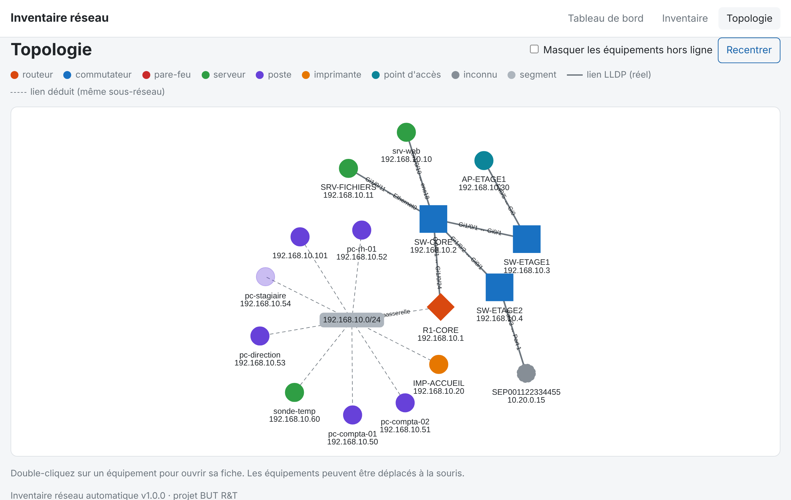

# Inventaire réseau automatique

Projet de 3e année de **BUT Réseaux & Télécommunications**.

Outil qui **découvre automatiquement** les équipements d'un réseau IP,
les **inventorie** dans une base de données et **affiche la topologie**
dans une interface web.



## Fonctionnalités

- **Découverte** d'un sous-réseau : ping ICMP parallèle + cache ARP (les
  hôtes qui bloquent le ping, comme Windows, sont quand même trouvés).
- **Identification** : adresse MAC, constructeur (OUI IEEE), nom DNS,
  services TCP ouverts, identité SNMP (`sysName`, `sysDescr`).
- **Type d'équipement** déduit automatiquement (routeur, commutateur,
  serveur, poste, imprimante, borne Wi-Fi, pare-feu) **avec sa
  justification** (ex. « sysServices=78 : couches 2 et 3 »).
- **Topologie réelle** à partir des voisins **LLDP** lus en SNMP : liens
  port à port entre équipements.
- **Historique** : première et dernière apparition, détection des
  équipements nouveaux, disparus ou réapparus.
- **Interface web** : tableau de bord, inventaire filtrable, fiche par
  équipement, graphe interactif, exports CSV / JSON, API JSON.
- **SNMP v2c et v3** (authentification SHA, chiffrement AES).
- Fonctionne **hors ligne** (aucun CDN), **sans droits root**.

## Démarrage rapide

```bash
sudo apt install -y python3-venv iputils-ping iproute2 snmp
git clone https://github.com/Admm3bnhd/SAE51.git
cd SAE51
python3 -m venv .venv && source .venv/bin/activate
pip install -r requirements.txt

python -m inventaire demo            # réseau fictif, pour essayer
python -m inventaire web             # → http://127.0.0.1:5000
```

Sur un vrai réseau (dont vous êtes administrateur) :

```bash
cp config.example.ini config.ini     # communauté SNMP, etc.
python -m inventaire scan 192.168.1.0/24
python -m inventaire web
```

Sans matériel, un labo virtuel de 3 machines (namespaces Linux, snmpd,
lldpd) se lance en une commande :

```bash
sudo apt install -y snmpd lldpd
sudo scripts/labo_veth.sh start
python -m inventaire scan 10.99.0.0/24
```

## Comment ça marche


| Technique | Ce qu'elle apporte |
|---|---|
| ICMP (ping) | Hôtes actifs |
| ARP (`ip neigh`) | Adresse MAC, hôtes qui filtrent ICMP |
| OUI IEEE | Constructeur de la carte réseau |
| DNS inverse | Nom de l'hôte |
| Connexion TCP | Services (SSH, web, SMB, RDP, impression…) |
| SNMP (`sysDescr`, `sysName`, `sysServices`) | Identité et rôle (couches OSI) |
| LLDP via SNMP (LLDP-MIB) | Liens physiques réels entre équipements |

## Documentation

| Chapitre | Contenu |
|---|---|
| [1. Cahier des charges](docs/01-cahier-des-charges.md) | Contexte, besoins, contraintes, livrables |
| [2. État de l'art](docs/02-etat-de-l-art.md) | Protocoles de découverte, outils existants, choix techniques |
| [3. Architecture](docs/03-architecture.md) | Modules, déroulement d'un scan, données, classification, topologie |
| [4. Installation](docs/04-installation.md) | Prérequis, installation, configuration |
| [5. Utilisation](docs/05-utilisation.md) | Commandes, interface, configuration des équipements Cisco / Linux |
| [6. Tests](docs/06-tests.md) | Tests unitaires, labo virtuel, maquette GNS3, plan de recette |
| [7. Sécurité et limites](docs/07-securite-et-limites.md) | Cadre légal, sécurité, limites, améliorations |
| [8. Gestion de projet](docs/08-gestion-de-projet.md) | Lots, planning, répartition, risques |

## Arborescence

```
inventaire-reseau/
├── inventaire/              Code Python
│   ├── __main__.py          Ligne de commande (scan, web, demo)
│   ├── config.py            Lecture de config.ini
│   ├── decouverte.py        Ping, ARP, DNS, ports TCP
│   ├── oui.py               Constructeurs (OUI)
│   ├── snmp.py              SNMP et LLDP-MIB
│   ├── classification.py    Type d'équipement
│   ├── scanner.py           Orchestration d'un scan
│   ├── base.py              Base SQLite, détection des changements
│   ├── topologie.py         Construction du graphe
│   ├── demo.py              Réseau de démonstration
│   └── web/                 Interface Flask (gabarits, CSS, JS)
├── tests/                   Tests pytest (62 tests)
├── scripts/
│   ├── labo_veth.sh         Labo virtuel de test
│   └── telecharger_oui.sh   Base IEEE des constructeurs
├── docs/                    Documentation
└── config.example.ini       Modèle de configuration
```

## Tests

```bash
pip install -r requirements-dev.txt
python -m pytest
```

## Avertissement

Ne scannez **que des réseaux dont vous avez l'autorisation**
(article 323-1 du Code pénal). L'outil est en lecture seule, mais un scan
peut déclencher des alertes de sécurité.

## Licence

[MIT](LICENSE). La bibliothèque embarquée vis-network est sous licence
Apache-2.0 / MIT (voir `inventaire/web/static/vendor/README.md`).
