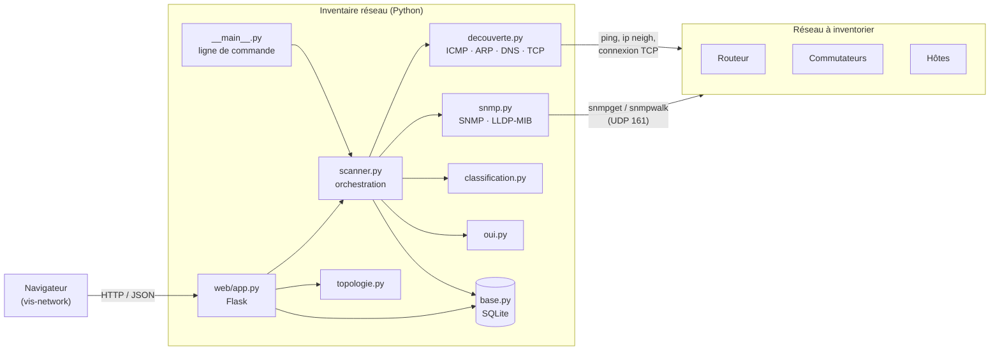
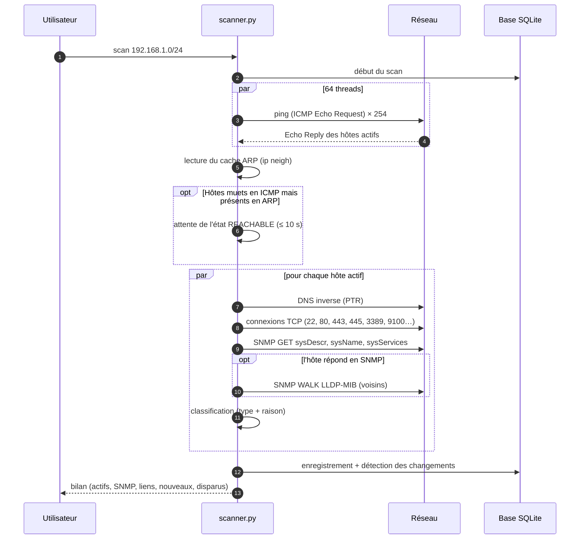
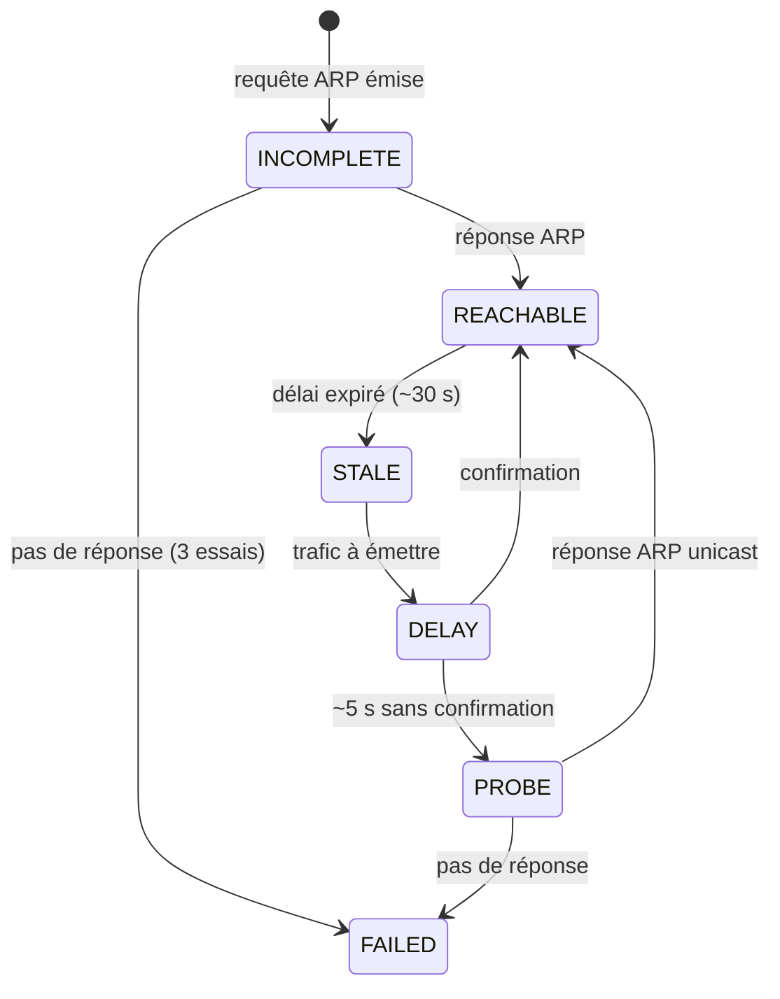
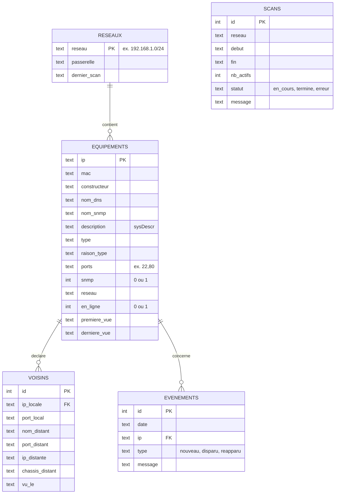
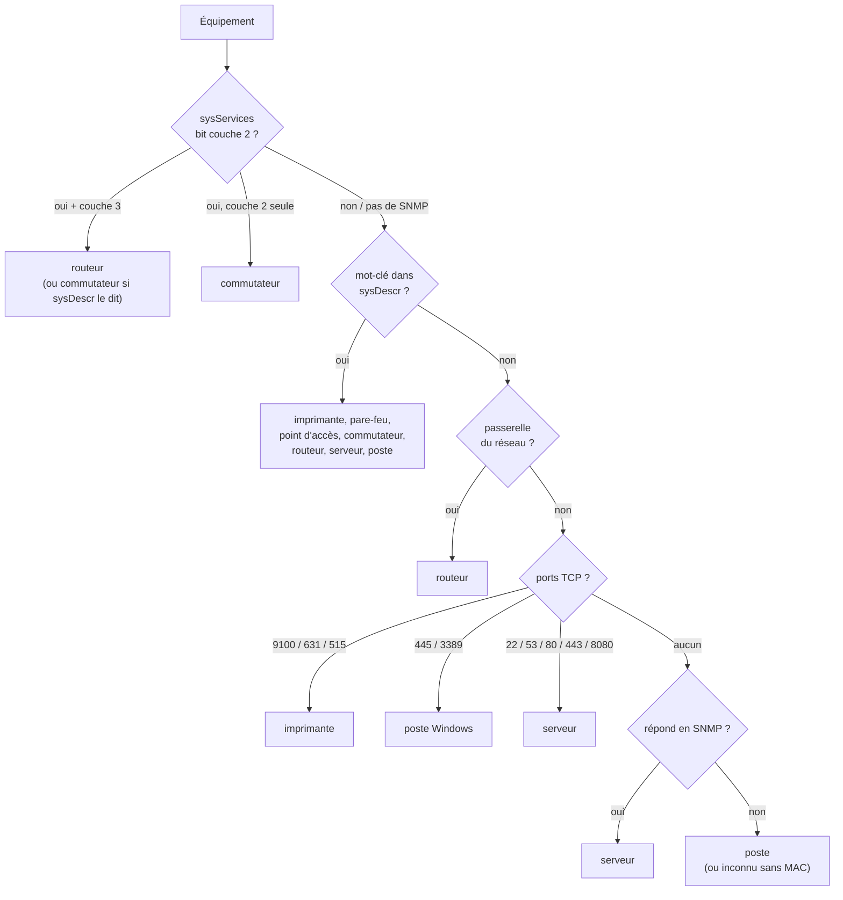

# 3. Architecture et conception

## 3.1 Vue d'ensemble

L'outil est une application Python unique, composée de modules qui ont
chacun **une seule responsabilité**. Il s'utilise de deux façons :

- en **ligne de commande** (`python -m inventaire scan ...`), par exemple
  dans une tâche planifiée ;
- via l'**interface web** (`python -m inventaire web`), qui permet aussi
  de lancer un scan.

## 3.2 Rôle des modules

| Module | Rôle | Dépend de |
|---|---|---|
| `config.py` | Lecture de `config.ini`, valeurs par défaut | – |
| `decouverte.py` | Ping parallèle, cache ARP, passerelle, DNS inverse, ports TCP | commandes `ping`, `ip` |
| `oui.py` | Constructeur d'après le préfixe OUI de la MAC | fichier IEEE (optionnel) |
| `snmp.py` | Identité SNMP (`sysDescr`, `sysName`, `sysServices`) et voisins LLDP | commandes Net-SNMP |
| `classification.py` | Type d'équipement + justification | – |
| `scanner.py` | Enchaîne les étapes d'un scan | modules ci-dessus |
| `base.py` | Schéma SQLite, enregistrement, détection des changements | `sqlite3` |
| `topologie.py` | Construction du graphe (nœuds, liens) | – |
| `web/app.py` | Pages HTML, API JSON, exports, scan en arrière-plan | Flask |
| `demo.py` | Réseau fictif pour les présentations | `base`, `classification` |
| `__main__.py` | Commandes `scan`, `web`, `demo` | `argparse` |

Les fonctions qui **analysent du texte** (`analyser_ip_neigh`,
`analyser_walk`, `construire_voisins`...) sont séparées des fonctions qui
**lancent des commandes**. On peut ainsi les tester avec des sorties
enregistrées, sans réseau (voir [06-tests.md](06-tests.md)).

## 3.3 Déroulement d'un scan

### Le cas des hôtes qui filtrent ICMP

Le pare-feu de Windows bloque le ping par défaut. Mais pour envoyer un
ping à une adresse du même sous-réseau, le noyau doit d'abord connaître sa
MAC : il émet une **requête ARP**, à laquelle l'hôte répond toujours (sans
cela, aucune communication IP ne serait possible). L'hôte apparaît donc
dans le cache ARP même s'il ignore le ping.

Le cache peut toutefois contenir des **entrées périmées** (hôte éteint
depuis le dernier scan). Le noyau Linux gère chaque entrée avec une
machine d'états (*Neighbour Unreachability Detection*) :

L'outil ne retient un hôte muet en ICMP que si son entrée arrive à
**REACHABLE** ; il relit la table tant que l'entrée est en STALE, DELAY ou
PROBE (fonction `confirmer_par_arp`). Ce comportement a été vérifié sur le
labo : un hôte dont l'interface est coupée est bien déclaré « disparu »,
un hôte qui ignore le ping est bien trouvé.

## 3.4 Modèle de données

Choix de conception :

- **L'adresse IP est la clé** d'un équipement. C'est simple et suffisant
  pour un réseau à adressage stable. Avec du DHCP, un même appareil peut
  changer d'IP (voir les limites, [07-securite-et-limites.md](07-securite-et-limites.md)).
- Les **voisins LLDP** sont stockés tels que déclarés. La mise en
  correspondance avec l'inventaire est faite à l'affichage
  (`topologie.py`), ce qui la garde à jour même si l'inventaire change.
- Un scan est **une seule transaction** SQLite : en cas d'erreur, la base
  n'est pas laissée dans un état intermédiaire.

### Détection des changements

À la fin de chaque scan, pour le réseau scanné :

| Situation | Action | Événement |
|---|---|---|
| IP jamais vue | création, `en_ligne = 1` | **nouveau** |
| IP connue, en ligne | mise à jour, `derniere_vue` | – |
| IP connue, hors ligne, de nouveau vue | `en_ligne = 1` | **réapparu** |
| IP en ligne dans ce réseau mais pas vue | `en_ligne = 0` | **disparu** |

Les informations d'identité (MAC, noms, description) sont conservées si
le scan ne les a pas obtenues cette fois-ci (SNMP qui n'a pas répondu à
temps par exemple). Les ports et le type sont toujours mis à jour.

## 3.5 Classification des équipements

Les règles sont appliquées de la plus fiable à la moins fiable ; la
première qui s'applique donne le type, accompagné d'une **raison**
affichée dans la fiche de l'équipement.

**Pourquoi exiger le bit couche 2 ?** Un serveur Windows annonce
`sysServices = 76` (couches 3, 4 et 7) : il implémente IP, donc le bit
couche 3 est positionné, mais ce n'est pas un routeur. Ce cas a été
détecté pendant le développement (le serveur de fichiers de la démo était
classé « routeur ») et corrigé. Les routeurs et commutateurs Cisco
annoncent le bit couche 2 (78, 6 ou 2).

## 3.6 Construction de la topologie

Le graphe contient deux sortes de liens :

| Lien | Représentation | Origine | Fiabilité |
|---|---|---|---|
| **LLDP** | trait plein, avec les ports `Gi0/1 ↔ eth0` | déclaré par un équipement dans sa LLDP-MIB | lien physique réel |
| **déduit** | pointillés | l'équipement est dans le sous-réseau mais n'a déclaré aucun voisin | appartenance au réseau seulement |

Algorithme (`topologie.construire`) :

1. Un nœud par équipement de l'inventaire.
2. Pour chaque voisin LLDP déclaré, on cherche l'équipement correspondant
   **par IP d'administration, puis par MAC de châssis, puis par nom**
   (sans le domaine, insensible à la casse). Un équipement annonce souvent
   l'IP d'une autre de ses interfaces que celle qui a été scannée : c'est
   ce qui s'est produit sur le labo, où le poste annonçait `192.0.2.2` ; la
   correspondance par MAC a permis de le retrouver.
3. Un voisin introuvable (téléphone IP dans un autre VLAN, réseau non
   scanné...) est ajouté comme nœud **hors inventaire** plutôt que perdu.
4. Un lien A–B est généralement déclaré **deux fois** (par A et par B). On
   regroupe les déclarations par paire et on garde celles de l'équipement
   qui en déclare le plus. Cela supprime les doublons tout en conservant
   les **liens parallèles** (agrégation de liens).
5. Les équipements sans aucun lien LLDP sont reliés en pointillés à un
   nœud **segment** (le sous-réseau), lui-même relié à la passerelle.

## 3.7 Interface web

| URL | Contenu |
|---|---|
| `/` | Tableau de bord : chiffres clés, répartition par type, derniers changements, derniers scans, formulaire de scan |
| `/inventaire` | Tableau filtrable (texte, type, en ligne), exports |
| `/equipement/<ip>` | Fiche : identité, raison du type, sysDescr, voisins LLDP, historique |
| `/topologie` | Graphe interactif, légende, masquage des équipements hors ligne |
| `/api/equipements` | Inventaire en JSON |
| `/api/topologie` | Graphe en JSON (`noeuds`, `liens`) |
| `/api/scan` | État du scan en cours (journal) |
| `/export.csv`, `/export.json` | Téléchargement de l'inventaire |

Le scan lancé depuis l'interface tourne dans un **thread** séparé ; la
page interroge `/api/scan` toutes les 2 secondes pour afficher sa
progression. Un seul scan peut tourner à la fois (verrou).

SQLite interdit de partager une connexion entre threads : chaque requête
HTTP et chaque scan ouvrent leur propre connexion.
