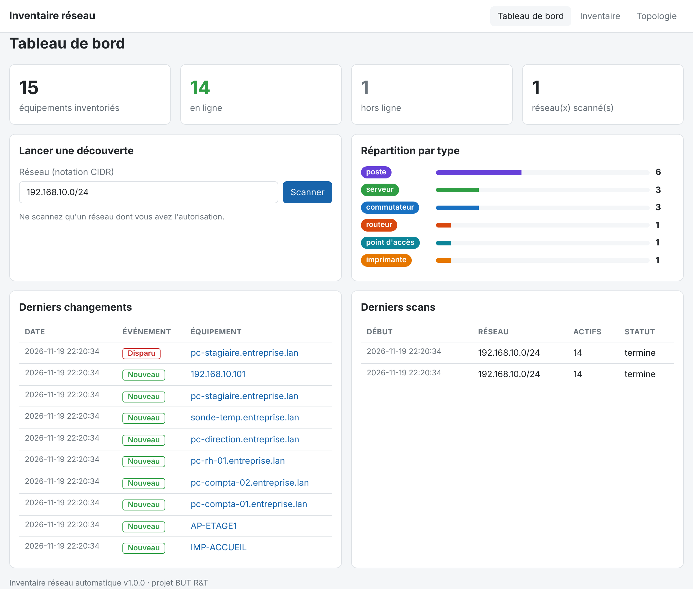
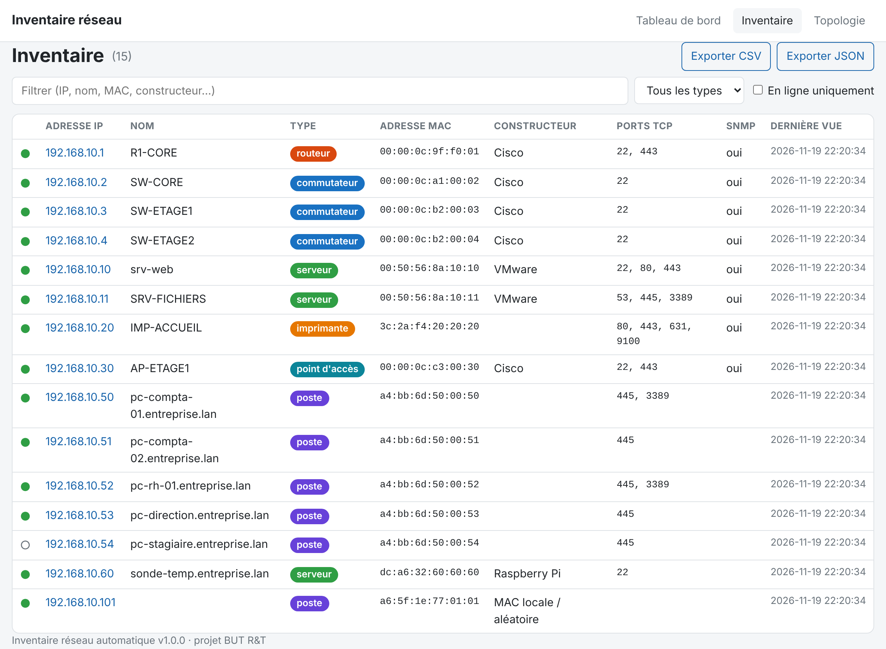
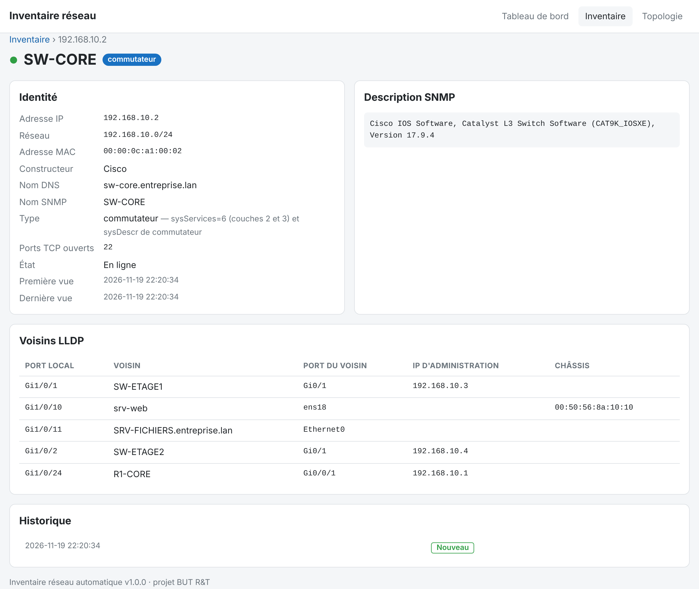
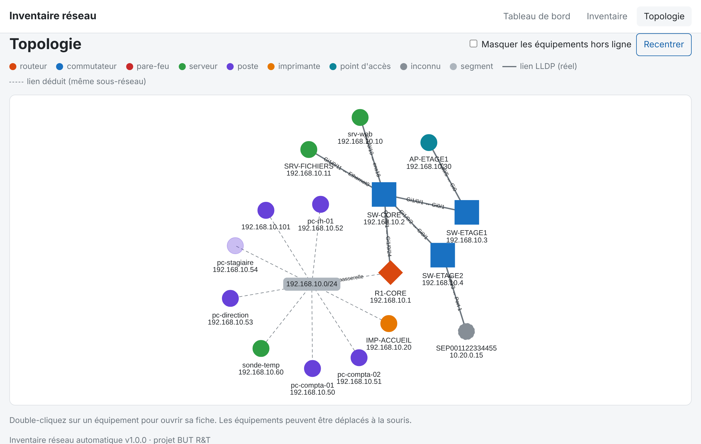

# 5. Utilisation

## 5.1 Ligne de commande

```bash
python -m inventaire scan 192.168.1.0/24              # un réseau
python -m inventaire scan 192.168.1.0/24 10.0.0.0/24  # plusieurs réseaux
python -m inventaire scan 192.168.1.0/24 --communaute labo
python -m inventaire scan 192.168.1.0/24 --repeter 15 # toutes les 15 min
python -m inventaire web                              # http://127.0.0.1:5000
python -m inventaire web --hote 0.0.0.0 --port 8080   # accessible du réseau
python -m inventaire demo                             # réseau fictif
```

Exemple de sortie (labo de test) :

```
Ping de 254 adresses sur 10.99.0.0/24...
  2 hôte(s) ont répondu au ping
  Vérification ARP de 1 hôte(s) muet(s) en ICMP...
  1 hôte(s) supplémentaire(s) trouvé(s) par ARP (ICMP filtré)
Analyse de 3 hôte(s) (DNS, ports TCP, SNMP)...
Terminé en 4.2 s : 3 actif(s), 3 en SNMP, 5 lien(s) LLDP, 0 nouveau(x), 0 disparu(s)
```

Pour un scan automatique sans laisser de terminal ouvert, on peut aussi
utiliser **cron** (`crontab -e`) :

```
*/30 * * * * cd /opt/inventaire-reseau && .venv/bin/python -m inventaire scan 192.168.1.0/24 >> scan.log 2>&1
```

## 5.2 Interface web

### Tableau de bord



Chiffres clés, répartition des équipements par type, derniers
changements (nouveau, disparu, réapparu) et historique des scans. Le
formulaire lance un scan en arrière-plan ; son journal s'affiche en
direct.

### Inventaire



Le champ de recherche filtre sur toutes les colonnes (IP, nom, MAC,
constructeur...). Les boutons d'export produisent un fichier **CSV**
(séparateur `;`, s'ouvre directement dans Excel en français) ou **JSON**.

### Fiche d'un équipement



On y trouve notamment la **raison** du type choisi (ex.
« sysServices=6 (couches 2 et 3) et sysDescr de commutateur ») et la
liste des voisins LLDP avec les ports.

### Topologie



- **Forme** : losange = routeur, carré = commutateur, triangle =
  pare-feu, rond = hôte, rectangle gris = sous-réseau.
- **Trait plein** : lien LLDP réel, avec les ports aux deux extrémités.
- **Pointillés** : équipement rattaché à son sous-réseau, sans
  information de câblage.
- **Contour pointillé** : voisin LLDP hors inventaire (ici un téléphone
  IP du VLAN voix, non scanné).
- Équipement **pâle** : hors ligne.

Survoler un nœud affiche ses détails ; un double-clic ouvre sa fiche.

## 5.3 Préparer les équipements du réseau

Sans SNMP, l'outil trouve les hôtes, leur MAC, leur constructeur, leur
nom DNS et leurs services, mais pas les liens physiques. Pour obtenir la
topologie réelle, il faut **activer SNMP (lecture seule) et LLDP** sur les
équipements d'interconnexion.

### Cisco IOS (routeur ou commutateur)

```
enable
configure terminal
! LLDP (désactivé par défaut sur IOS, contrairement à CDP)
lldp run
! SNMP v2c en lecture seule, limité à la machine d'inventaire (ACL)
ip access-list standard SNMP-INVENTAIRE
 permit host 192.168.1.50
snmp-server community labo RO SNMP-INVENTAIRE
end
write memory
```

Vérification sur l'équipement : `show lldp neighbors`.

En **SNMPv3** (recommandé hors TP) :

```
snmp-server group INVENTAIRE v3 priv
snmp-server user inventaire INVENTAIRE v3 auth sha MotDePasseAuth priv aes 128 MotDePassePriv
```

et dans `config.ini` :

```ini
[snmp]
version = 3
utilisateur = inventaire
niveau = authPriv
auth_protocole = SHA
auth_motdepasse = MotDePasseAuth
priv_protocole = AES
priv_motdepasse = MotDePassePriv
```

### Serveur Linux (Debian/Ubuntu)

```bash
sudo apt install snmpd lldpd
```

`/etc/snmp/snmpd.conf` :

```
agentAddress udp:161
rocommunity labo 192.168.1.50
# Permet à lldpd de publier ses voisins dans la LLDP-MIB
master agentx
```

`/etc/default/lldpd` :

```
DAEMON_ARGS="-x"
```

```bash
sudo systemctl restart snmpd lldpd
lldpcli show neighbors          # voisins vus par lldpd
snmpwalk -v2c -c labo -On localhost 1.0.8802.1.1.2.1.4.1.1.9   # lldpRemSysName
```

### Vérifier depuis la machine d'inventaire

```bash
snmpget  -v2c -c labo -On 192.168.1.1 1.3.6.1.2.1.1.5.0          # sysName
snmpwalk -v2c -c labo -On 192.168.1.1 1.0.8802.1.1.2.1.4.1.1.9   # voisins LLDP
```

Si ces commandes répondent, l'outil obtiendra les mêmes informations.

## 5.4 Dépannage

| Symptôme | Cause probable | Solution |
|---|---|---|
| « Attention : outils Net-SNMP absents » | paquet `snmp` non installé | `sudo apt install snmp` |
| Colonne SNMP vide partout | mauvaise communauté, ACL, pare-feu UDP 161 | tester `snmpget` à la main |
| Aucun lien LLDP | LLDP désactivé, ou lldpd sans `-x` | `lldp run` (Cisco), `DAEMON_ARGS="-x"` (Linux) |
| Hôtes d'un autre sous-réseau sans MAC | ARP ne traverse pas les routeurs | normal (voir limites) |
| Scan lent | beaucoup d'adresses muettes | réduire `delai_ping` / `delai_tcp`, augmenter `threads` |
| « Réseau trop grand » | masque inférieur à /16 | découper en plusieurs scans |
