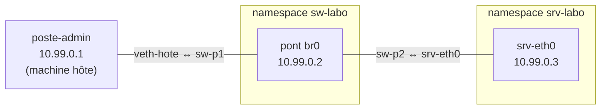
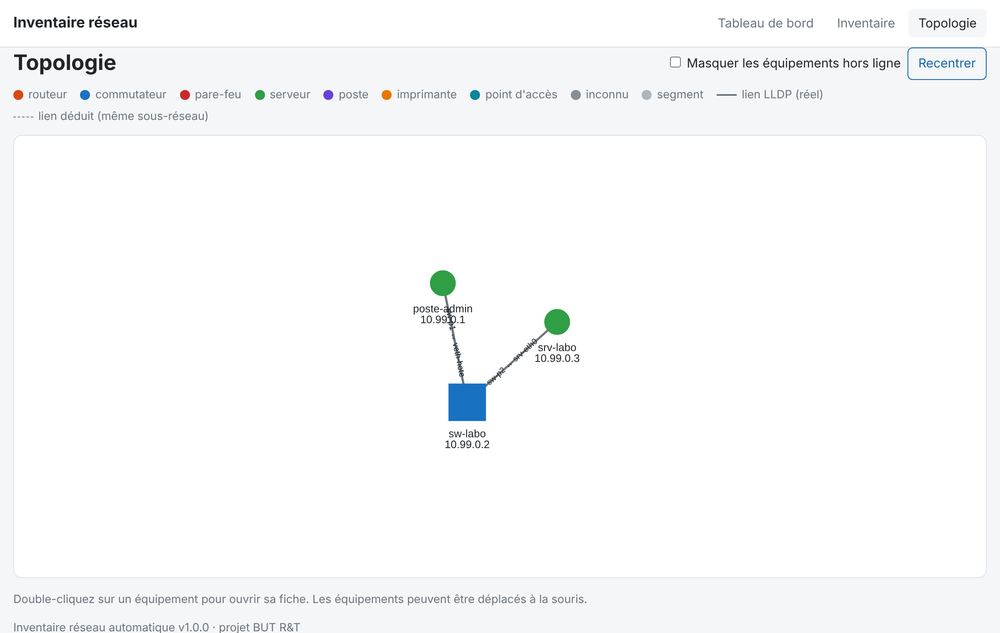
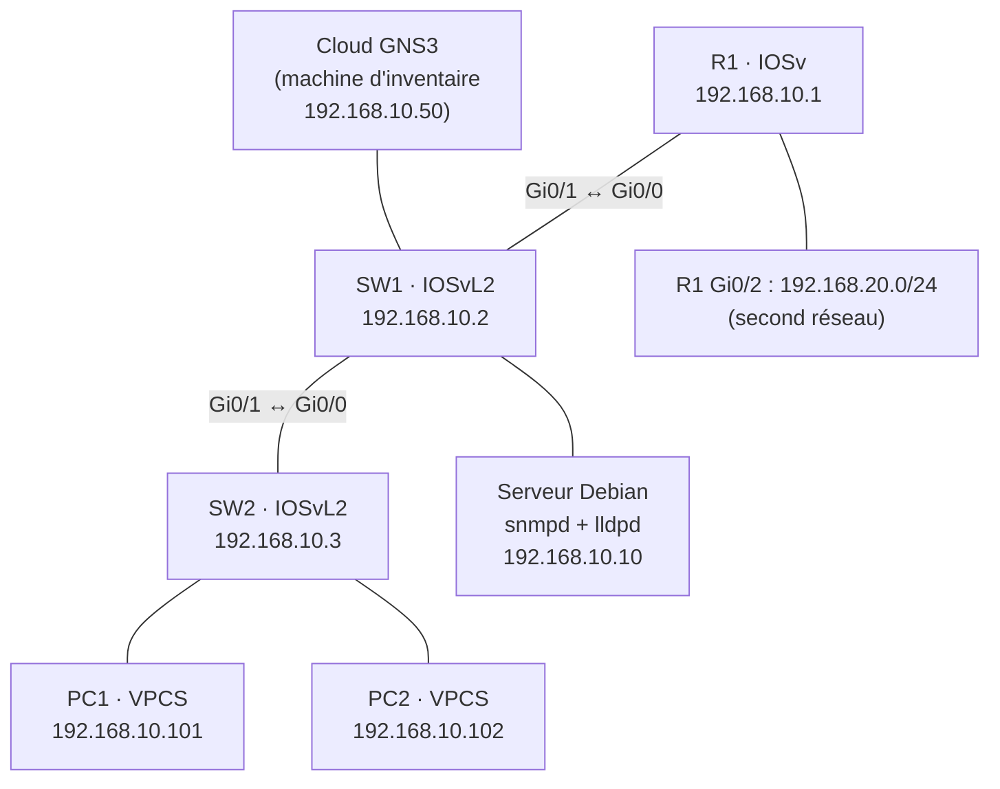

# 6. Tests et validation

La validation se fait à trois niveaux :

| Niveau | Outil | Ce qui est vérifié | Réseau nécessaire |
|---|---|---|---|
| Tests unitaires | `pytest` | Chaque fonction, avec des sorties de commandes enregistrées | Non |
| Labo virtuel | `scripts/labo_veth.sh` | Scan complet réel : ICMP, ARP, SNMP, LLDP, topologie | Non (une machine Linux) |
| Maquette GNS3 / salle de TP | GNS3 ou matériel Cisco | Comportement avec de vrais équipements réseau | Oui |

## 6.1 Tests unitaires

```bash
pip install -r requirements-dev.txt
python -m pytest -v
```

62 tests, exécutés en moins d'une seconde :

| Fichier | Nb | Contenu |
|---|---|---|
| `test_decouverte.py` | 18 | Liste des hôtes d'un CIDR, analyse de `ip neigh` / `ip route` / `ip addr`, états ARP, normalisation des MAC, constructeurs OUI, MAC aléatoires, test de port TCP sur un vrai serveur local |
| `test_snmp.py` | 8 | Options v2c/v3, analyse de `snmpwalk` (valeurs multilignes, « No Such Object »), reconstruction des voisins LLDP |
| `test_classification.py` | 16 | Un cas par règle de classification, dont le piège Windows `sysServices=76` |
| `test_topologie.py` | 6 | Dédoublonnage des liens, liens parallèles, correspondance par MAC et par nom, voisin hors inventaire, segments |
| `test_base.py` | 6 | Événements nouveau/disparu/réapparu, isolement des réseaux, conservation de l'identité, tri des IP |
| `test_web.py` | 8 | Pages, erreur 404, API topologie, export CSV, refus d'un réseau invalide |

Les sorties SNMP utilisées dans `test_snmp.py` sont des **captures
réelles** faites sur le labo virtuel : on teste donc l'analyse sur
exactement ce que renvoient snmpd et lldpd.

Les appels aux commandes système sont remplacés par des fonctions de test
(`monkeypatch` de pytest) : les tests sont reproductibles et fonctionnent
sur n'importe quelle machine, même sans Net-SNMP.

## 6.2 Labo virtuel (namespaces Linux)

Le script `scripts/labo_veth.sh` crée sur une seule machine un réseau de
trois « machines » grâce aux **namespaces réseau** du noyau Linux (chaque
namespace a ses propres interfaces, table de routage et cache ARP) :



Chaque nœud fait tourner **snmpd** (communauté `public`) et **lldpd**
connecté à snmpd en sous-agent **AgentX**, exactement comme sur un serveur
Linux réel. Le pont Linux joue le rôle de commutateur (`sysServices=2`).

```bash
sudo apt install iproute2 snmp snmpd lldpd
sudo scripts/labo_veth.sh start
python -m inventaire scan 10.99.0.0/24
python -m inventaire web
sudo scripts/labo_veth.sh stop
```

Résultat obtenu : 3 équipements, 2 liens LLDP réels.



Scénarios supplémentaires reproductibles sur ce labo :

```bash
# Hôte qui ignore le ping (comme le pare-feu Windows par défaut)
sudo ip netns exec srv-labo sysctl -w net.ipv4.icmp_echo_ignore_all=1
python -m inventaire scan 10.99.0.0/24     # → trouvé par ARP

# Hôte éteint (câble débranché)
sudo ip -n srv-labo link set srv-eth0 down
python -m inventaire scan 10.99.0.0/24     # → « disparu »
```

## 6.3 Maquette GNS3 proposée

Pour valider l'outil sur de vrais systèmes réseau, on propose la maquette
suivante (images Cisco IOSv et IOSvL2 fournies avec les licences
académiques, ou équipements de la salle de TP) :



Configuration minimale des équipements Cisco : voir
[05-utilisation.md § 5.3](05-utilisation.md#53-préparer-les-équipements-du-réseau)
(`lldp run`, `snmp-server community ... RO`, adresse IP de gestion sur
`interface Vlan1` pour les commutateurs).

Résultat attendu : R1, SW1, SW2 et le serveur reliés par des liens LLDP
en trait plein, PC1 et PC2 (VPCS ne parle pas LLDP) rattachés en
pointillés au segment 192.168.10.0/24.

## 6.4 Plan de recette

Chaque besoin du cahier des charges ([01](01-cahier-des-charges.md)) est
vérifié par au moins un test. Colonne « Résultat » : **OK** = vérifié
pendant le développement (tests unitaires ou labo virtuel) ;
**À faire** = à réaliser sur la maquette GNS3 / en salle de TP.

| ID | Test | Résultat attendu | Moyen | Résultat |
|---|---|---|---|---|
| F1 | `scan 10.99.0.0/24` ; `scan n'importe-quoi` ; `scan 10.0.0.0/8` | Scan lancé ; erreur « réseau invalide » ; « réseau trop grand » | labo, `test_decouverte` | OK |
| F2 | Scan du labo, puis hôte avec `icmp_echo_ignore_all=1` | 3 hôtes ; l'hôte muet est trouvé par ARP | labo | OK |
| F2 | Interface d'un hôte coupée, puis scan | L'hôte n'est **pas** compté actif (entrée ARP périmée écartée) | labo | OK |
| F3 | MAC VMware / Raspberry Pi / aléatoire | « VMware », « Raspberry Pi », « MAC locale / aléatoire » | `test_decouverte` | OK |
| F4 | Nom SNMP du labo | `poste-admin`, `sw-labo`, `srv-labo` | labo | OK |
| F5 | Port TCP ouvert puis fermé | Détecté puis non détecté | `test_decouverte` | OK |
| F6 | `snmpget` sur un hôte avec et sans agent SNMP | Identité lue ; `None` sans erreur | labo, `test_snmp` | OK |
| F7 | Équipements de la démo et du labo | Types corrects avec raison (cf. 16 cas de `test_classification`) | tests, labo | OK |
| F8 | Topologie du labo | 2 liens LLDP, ports `veth-hote ↔ sw-p1` et `sw-p2 ↔ srv-eth0` | labo | OK |
| F8 | Topologie GNS3 avec IOSv/IOSvL2 | Liens LLDP Cisco avec noms de ports `Gi0/x` | GNS3 | À faire |
| F9 | Redémarrage de l'application | Inventaire et historique conservés (SQLite) | manuel | OK |
| F10 | Hôte coupé puis rétabli | Événements « disparu » puis « réapparu » | labo, `test_base` | OK |
| F11 | Filtre « srv » puis type « commutateur » (démo) | 2 lignes (srv-web, SRV-FICHIERS) puis 3 lignes | navigateur automatisé (Playwright) | OK |
| F12 | Page topologie, double-clic sur un nœud | Graphe affiché ; ouverture de la fiche | navigateur automatisé (Playwright) | OK |
| F13 | Scan lancé depuis le tableau de bord | Journal affiché en direct, page rechargée à la fin | labo | OK |
| F14 | Export CSV relu avec un lecteur CSV (UTF-8 avec BOM, séparateur `;`) | 15 lignes, 13 colonnes, accents corrects | `test_web`, relecture | OK |
| F14 | Export CSV ouvert dans Excel / LibreOffice | Colonnes séparées, accents corrects | manuel | À faire |
| F15 | `python -m inventaire demo` | 15 équipements, 7 liens LLDP, événements | `test_web` | OK |
| NF2 | Durée du scan d'un /24 (labo) | < 60 s | labo | OK (≈ 4 s ; ≈ 9 s si une vérification ARP est nécessaire) |
| NF4 | Page topologie : requêtes vers d'autres serveurs | Aucune (vis-network embarqué) | navigateur automatisé (Playwright) | OK |
| NF6 | `python -m inventaire web` | Écoute sur 127.0.0.1 uniquement | manuel | OK |
| – | SNMPv3 authPriv (SHA + AES) sur snmpd : bon mot de passe, mauvais mot de passe, mots de passe dans `~/.snmp/snmp.conf` | Identité et voisins LLDP lus ; refus sans erreur ; lecture OK | labo | OK |
| – | SNMPv3 authPriv sur IOSv | Identité et voisins lus | GNS3 | À faire |
| – | Scan d'une salle de TP réelle (~30 postes) | Postes Windows détectés malgré le pare-feu | salle de TP | À faire |

## 6.5 Anomalies trouvées et corrigées pendant les tests

| Anomalie | Détectée par | Correction |
|---|---|---|
| Un serveur Windows (`sysServices=76`) classé « routeur » | mode démo | Exiger le bit couche 2 en plus du bit couche 3 |
| Un hôte éteint compté actif car encore dans le cache ARP | labo (interface coupée) | Lecture de l'état NUD, attente de REACHABLE |
| Voisin LLDP non relié : il annonçait l'IP d'une autre interface | labo | Correspondance par MAC de châssis puis par nom |
| Premier échange LLDP du labo avec des noms provisoires | labo | Renvoi LLDP forcé (`lldpcli update`) une fois tous les agents prêts |
| Noms DNS longs illisibles sur le graphe | captures d'écran | Affichage du nom court (avant le premier point) |
