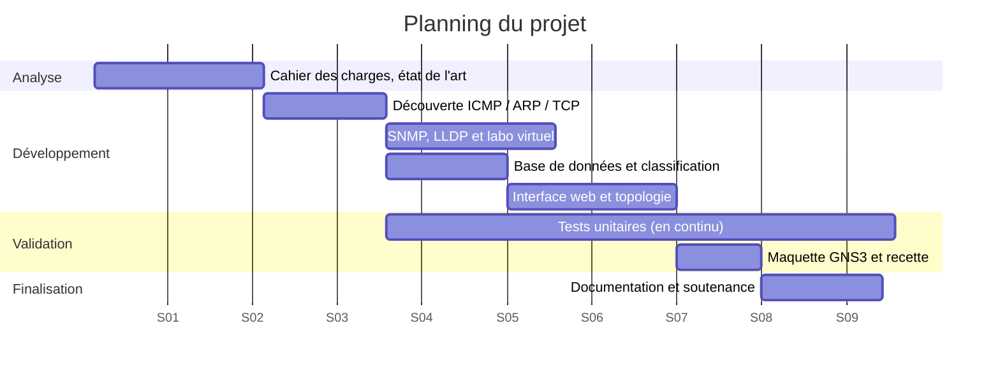

# 8. Gestion de projet

Ce chapitre propose une organisation pour mener le projet sur un
semestre. Il est à adapter à la taille du groupe et au calendrier réel.

## 8.1 Découpage en lots

| Lot | Contenu | Livrable | Modules |
|---|---|---|---|
| L1 – Analyse | Cahier des charges, état de l'art, choix techniques | docs 01 et 02 | – |
| L2 – Découverte | Ping parallèle, ARP, DNS, ports, constructeurs | inventaire en ligne de commande | `decouverte`, `oui` |
| L3 – SNMP / LLDP | Identité SNMP, voisins LLDP, labo virtuel | voisins affichés en console | `snmp`, `labo_veth.sh` |
| L4 – Données | Base SQLite, détection des changements, classification | historique des scans | `base`, `classification`, `scanner` |
| L5 – Interface web | Pages, API, topologie | interface utilisable | `web`, `topologie` |
| L6 – Validation | Tests unitaires, maquette GNS3, recette | plan de recette rempli | `tests`, doc 06 |
| L7 – Finalisation | Documentation, démonstration, soutenance | dépôt final, diaporama | docs |

## 8.2 Planning indicatif (12 semaines)

Jalons :

1. **Fin de semaine 2** : cahier des charges validé par l'encadrant.
2. **Fin de semaine 5** : un scan en ligne de commande affiche les hôtes
   et leurs voisins LLDP sur le labo.
3. **Fin de semaine 9** : interface web complète.
4. **Semaine 11** : recette sur la maquette GNS3.
5. **Semaine 12** : rendu et soutenance.

## 8.3 Répartition possible (groupe de 3)

| Rôle | Lots principaux | Compétences BUT R&T mobilisées |
|---|---|---|
| Réseau | L3, maquette GNS3, configuration Cisco/Linux | Administrer les réseaux (SNMP, LLDP, VLAN) |
| Développement | L2, L4 | Programmer (Python, SQL) |
| Interface et qualité | L5, L6 | Développer une application web, tester |

La documentation (L1, L7) est partagée : chacun documente ce qu'il
développe.

## 8.4 Méthode de travail

- **Git** : une branche par fonctionnalité, fusion dans `main` après
  relecture par un autre membre (*pull request*). Des messages de commit
  en français à l'impératif ou au nom (« Ajout de… », « Correction de… »)
  qui expliquent **pourquoi**, pas seulement quoi.
- **Tests** : chaque fonction d'analyse ajoutée s'accompagne d'un test ;
  `python -m pytest` doit passer avant chaque fusion.
- **Réunion hebdomadaire** courte : ce qui est fait, ce qui bloque, ce qui
  est prévu.
- **Suivi** : tableau de tâches (GitHub Projects ou Trello) à trois
  colonnes : à faire, en cours, terminé.

## 8.5 Risques

| Risque | Probabilité | Impact | Prévention |
|---|---|---|---|
| Pas d'accès à du matériel Cisco | Moyenne | Moyen | Labo virtuel par namespaces ; images IOSv dans GNS3 |
| Bibliothèque SNMP Python instable | Élevée | Élevé | Choix des commandes Net-SNMP (stables depuis 20 ans) |
| Scan d'un réseau sans autorisation | Faible | Très élevé | Limiter les tests au labo et à la maquette ; rappel dans l'interface |
| Retard sur l'interface web | Moyenne | Moyen | Ligne de commande utilisable seule dès la semaine 5 |
| Départ / absence d'un membre | Faible | Élevé | Code documenté, revue croisée, rien ne repose sur une seule personne |
