# Compte rendu – Inventaire réseau automatique

**Projet :** SAÉ 5.01 – Inventaire réseau automatique<br>
**Formation :** BUT Réseaux & Télécommunications, 3e année<br>
**Auteur :** Admm3bnhd<br>
**Date :** novembre 2026<br>
**Dépôt :** <https://github.com/Admm3bnhd/SAE51>

Ce compte rendu présente la solution réalisée, la structure du projet,
l'environnement de test mis en place, les résultats obtenus et les
difficultés rencontrées. **Toutes les captures de terminal et d'interface
proviennent d'exécutions réelles** sur le labo de test décrit au § 4 ; le
texte des sorties n'a pas été modifié (seule la mise en forme « fenêtre de
terminal » a été ajoutée).

---

## Sommaire

1. [Objectif](#1-objectif)
2. [Solution retenue](#2-solution-retenue)
3. [Structure du projet](#3-structure-du-projet)
4. [Mise en place de l'environnement de test](#4-mise-en-place-de-lenvironnement-de-test)
5. [Résultats des tests](#5-résultats-des-tests)
6. [Difficultés rencontrées et solutions](#6-difficultés-rencontrées-et-solutions)
7. [Bilan](#7-bilan)
8. [Annexe (reproduire les tests)](#8-annexe-reproduire-les-tests)

---

## 1. Objectif

Concevoir un outil qui :

1. **découvre** automatiquement les équipements d'un réseau IP ;
2. les **inventorie** (IP, MAC, constructeur, nom, type, services) avec un
   historique ;
3. **affiche** l'inventaire et la **topologie** dans une interface web.

Contraintes fixées : rester simple (installation en quelques commandes,
code lisible), ne rien modifier sur le réseau (lecture seule), fonctionner
sans Internet (salle de TP).

---

## 2. Solution retenue

### 2.1 Principe : combiner plusieurs protocoles

Aucune technique de découverte ne suffit seule : le ping est souvent
filtré, ARP ne fonctionne que sur le réseau local, et seul SNMP donne des
informations sur le rôle et les voisins d'un équipement. L'outil enchaîne
donc huit étapes, de la couche 2 à la couche 7 :

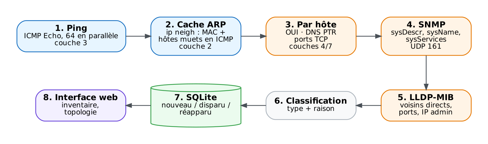

| Étape | Protocole | Information obtenue |
|---|---|---|
| 1 | ICMP (ping) | hôtes actifs |
| 2 | ARP (cache du noyau) | adresse MAC ; hôtes qui bloquent le ping |
| 3 | OUI IEEE, DNS (PTR), TCP | constructeur, nom, services ouverts |
| 4 | SNMP (MIB-II `system`) | nom, description, couches OSI assurées (`sysServices`) |
| 5 | SNMP (LLDP-MIB) | **voisins physiques directs** et ports |
| 6 | – | type d'équipement et justification |
| 7 | SQLite | historique, détection des changements |
| 8 | HTTP | interface web, graphe de topologie |

### 2.2 Choix techniques

| Besoin | Choix | Pourquoi |
|---|---|---|
| Langage | Python 3 | lisible, bibliothèque standard riche (`ipaddress`, `socket`, `sqlite3`, threads) |
| Ping, ARP | commandes `ping` et `ip neigh` | **pas besoin des droits root** (contrairement à Scapy) |
| SNMP | commandes Net-SNMP `snmpget` / `snmpwalk` | outils vus en TP, stables ; une requête peut être rejouée à la main pour déboguer |
| Base de données | SQLite | un seul fichier, aucun serveur à installer |
| Interface | Flask + vis-network | simple ; bibliothèque JavaScript **embarquée** (pas de CDN) |
| Tests | pytest | standard ; les commandes réseau sont simulées |

Les solutions professionnelles (LibreNMS, Netdisco) utilisent la même
approche SNMP + LLDP mais demandent une base MySQL/PostgreSQL et un
déploiement lourd. NetBox, lui, n'a pas de découverte automatique.

### 2.3 Obtenir la topologie réelle : LLDP lu en SNMP

LLDP (IEEE 802.1AB) est un protocole de couche 2 : chaque équipement
envoie périodiquement à ses voisins directs une trame contenant son nom,
le port d'émission et son adresse d'administration. Chaque équipement
stocke ce qu'il reçoit dans une base, la **LLDP-MIB**, que l'outil lit en
SNMP :

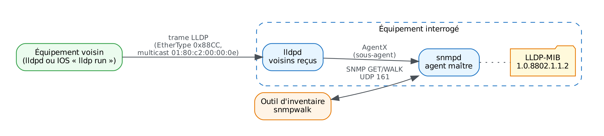

Voici une trame LLDP réelle capturée sur le labo avec `tcpdump`. On y
retrouve exactement les champs exploités par l'outil (nom `sw-labo`,
port `sw-p1`, adresse d'administration `10.99.0.2`) :

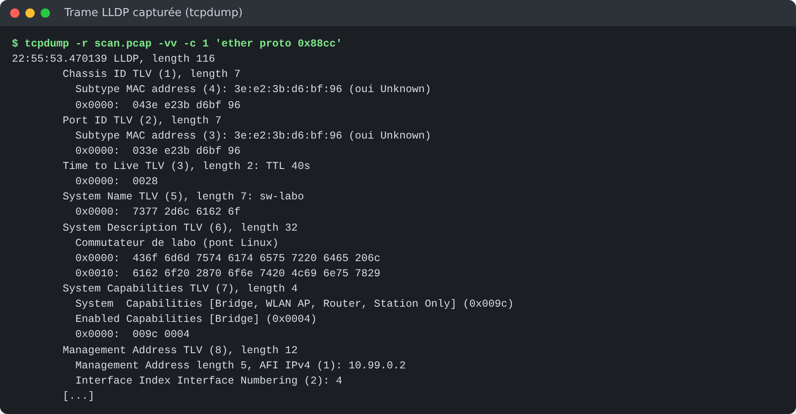

Les voisins déclarés sont ensuite reliés aux équipements de l'inventaire.
Un même lien étant déclaré par ses deux extrémités, il faut aussi
supprimer les doublons :

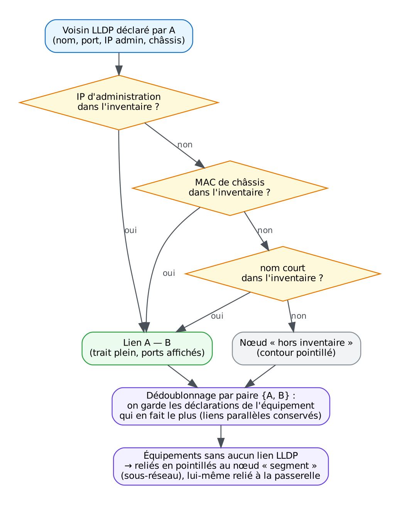

### 2.4 Déterminer le type d'un équipement

La règle la plus fiable utilise `sysServices` (RFC 1213), un entier dont
chaque bit indique une couche OSI assurée par l'équipement
(2^(couche−1)) :

| Valeur | Couches | Exemple | Type retenu |
|---|---|---|---|
| 78 = 2+4+8+64 | 2, 3, 4, 7 | routeur Cisco | routeur |
| 6 = 2+4 | 2, 3 | commutateur de niveau 3 | commutateur (si `sysDescr` l'indique) |
| 2 | 2 | commutateur de niveau 2 | commutateur |
| 72 = 8+64 | 4, 7 | Linux (Net-SNMP) | hôte → règles suivantes |
| 76 = 4+8+64 | 3, 4, 7 | **Windows** | hôte → règles suivantes |

Viennent ensuite des mots-clés dans `sysDescr` (« LaserJet », « Aironet »,
« pfSense »…), le rôle de passerelle, puis les ports TCP ouverts (9100 →
imprimante, 3389 → poste Windows, 22/80 → serveur). **Chaque décision est
accompagnée de sa raison**, affichée dans l'interface (ex. « sysServices=2 :
couche 2 seule (commutation) »).

---

## 3. Structure du projet

### 3.1 Architecture logicielle

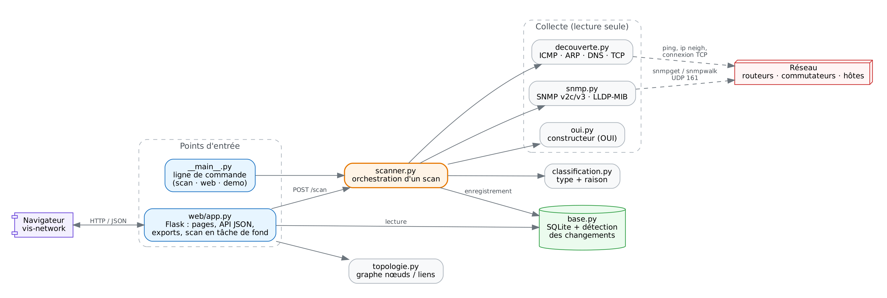

Chaque module a une responsabilité unique. Les fonctions qui **analysent
du texte** (sortie de `ip neigh`, de `snmpwalk`…) sont séparées de celles
qui **lancent les commandes**, ce qui permet de les tester sans réseau.

### 3.2 Arborescence

```
SAE51/
├── inventaire/                 Code (≈ 1 500 lignes Python + 580 HTML/CSS/JS)
│   ├── __main__.py             Commandes : scan, web, demo
│   ├── config.py               Lecture de config.ini
│   ├── decouverte.py           Ping, cache ARP, DNS, ports TCP
│   ├── oui.py                  Constructeur à partir de la MAC
│   ├── snmp.py                 SNMP v2c/v3, LLDP-MIB
│   ├── classification.py       Type d'équipement + raison
│   ├── scanner.py              Orchestration d'un scan
│   ├── base.py                 SQLite, détection des changements
│   ├── topologie.py            Construction du graphe
│   ├── demo.py                 Réseau fictif de démonstration
│   └── web/                    Interface Flask (gabarits, CSS, JS)
├── tests/                      63 tests pytest
├── scripts/
│   ├── labo_veth.sh            Labo virtuel de test
│   └── telecharger_oui.sh      Base IEEE des constructeurs
├── docs/                       Documentation (9 chapitres + schémas)
└── config.example.ini          Modèle de configuration
```

### 3.3 Données

Cinq tables SQLite : `equipements` (clé : adresse IP), `voisins` (liens
LLDP déclarés), `reseaux` (sous-réseaux scannés et passerelle), `scans`
(historique) et `evenements` (nouveau / disparu / réapparu). Un scan est
enregistré en **une seule transaction** : en cas d'erreur, la base reste
cohérente.

---

## 4. Mise en place de l'environnement de test

### 4.1 Environnement

| Élément | Version |
|---|---|
| Système | Ubuntu 24.04.5 LTS, noyau Linux 6.18 |
| Python / Flask / pytest | 3.13 / 3.1.3 / 9.2.0 |
| Net-SNMP (snmpd, snmpget, snmpwalk) | 5.9.4 |
| lldpd | 1.0.18 |
| tcpdump | 4.99.4 |
| Navigateur de test | Chromium piloté par Playwright |

### 4.2 Un labo virtuel sur une seule machine

Faute de matériel réseau disponible pendant le développement, j'ai
construit un labo virtuel avec les **namespaces réseau** du noyau Linux.
Chaque namespace possède ses propres interfaces, table de routage et cache
ARP : il se comporte comme une machine indépendante. Les machines sont
reliées par des **paires veth** (deux interfaces virtuelles reliées comme
par un câble), et un **pont Linux** joue le rôle de commutateur.

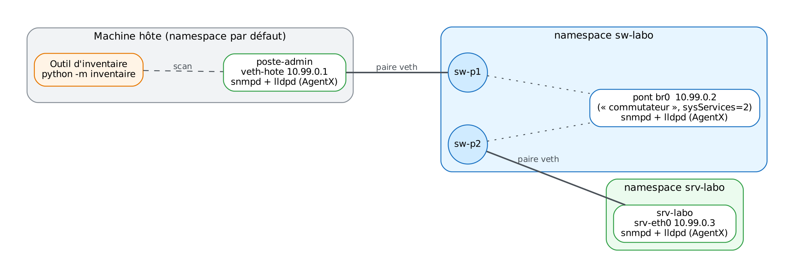

Sur chaque nœud tournent :

- **snmpd** (agent SNMP, communauté `public`, plus un utilisateur SNMPv3
  pour les tests de sécurité) ;
- **lldpd**, qui émet et reçoit les trames LLDP et publie ses voisins dans
  la LLDP-MIB en se connectant à snmpd comme **sous-agent AgentX**.

Le tout est automatisé par `scripts/labo_veth.sh start|stop`. Vérification
du labo (adressage et connectivité) :

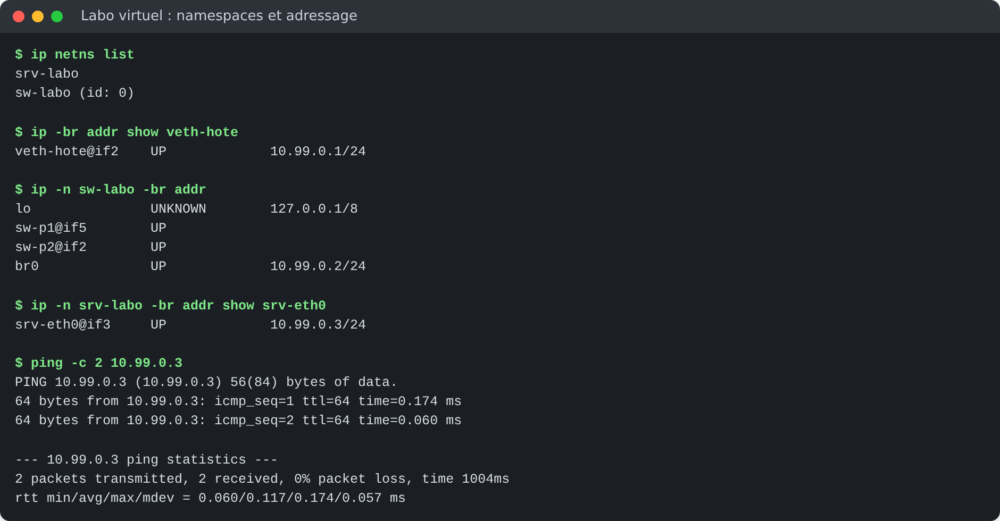

Le « commutateur » voit bien ses deux voisins LLDP, un sur chaque port :

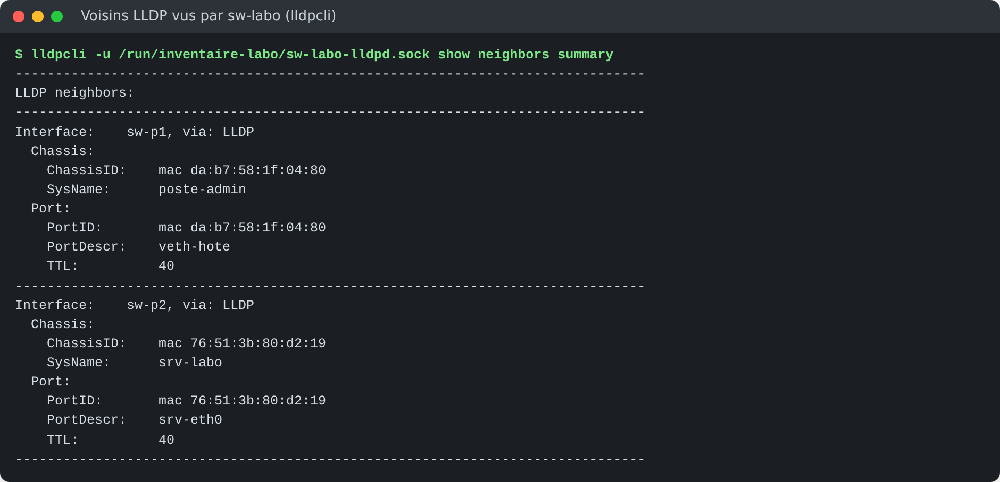

Et ces informations sont lisibles en SNMP, exactement comme sur un
commutateur Cisco (même LLDP-MIB normalisée) :

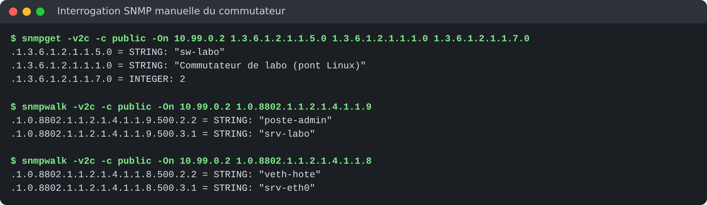

### 4.3 Données de démonstration

Pour présenter l'outil sans réseau, la commande `python -m inventaire demo`
crée un réseau d'entreprise fictif (routeur, 3 commutateurs, serveurs,
postes, imprimante, borne Wi-Fi, téléphone IP). Ces données passent par la
**vraie** classification et le **vrai** enregistrement en base.

---

## 5. Résultats des tests

### 5.1 Tests unitaires

63 tests automatisés couvrent l'analyse des sorties de commandes, SNMP et
LLDP (avec des sorties **capturées sur le labo**), la classification, la
topologie, la base de données et l'interface web. Ils passent tous en
moins d'une seconde :

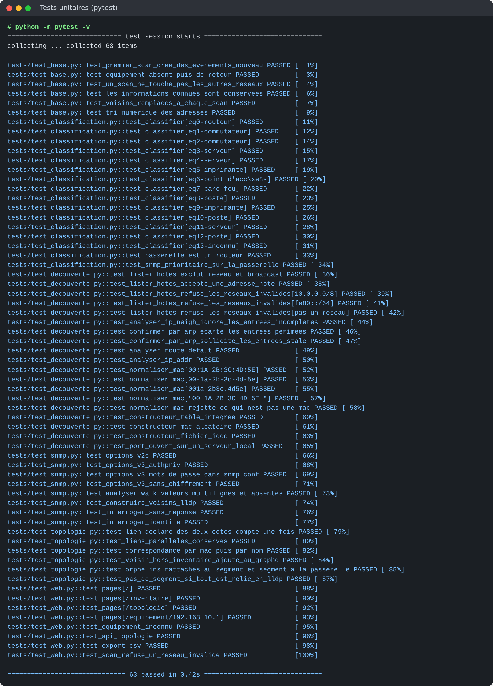

### 5.2 Scan du labo

Le premier scan trouve les 3 équipements, les interroge en SNMP et
récupère 4 déclarations LLDP (2 liens vus de chaque côté), en 4,2 s pour
254 adresses :

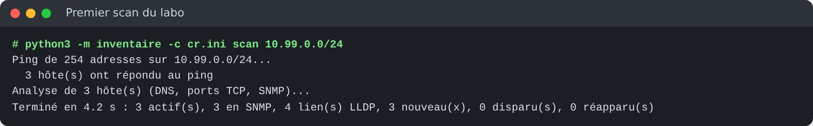

L'interface affiche la topologie **réelle**, avec les noms de ports aux
deux extrémités de chaque lien ; les 4 déclarations ont bien été
fusionnées en 2 liens (les nœuds ont été disposés à la souris pour la
capture) :

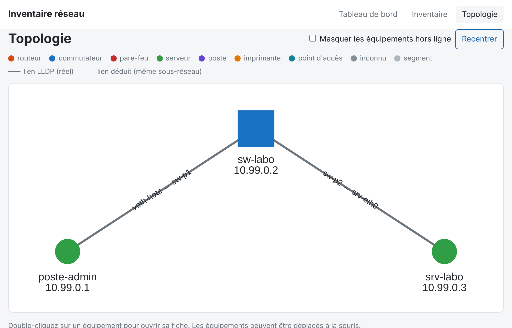

Inventaire correspondant :

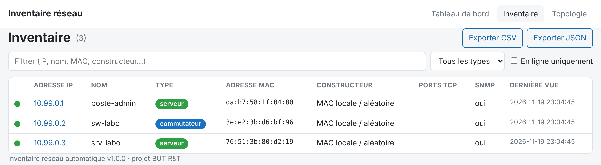

La fiche du commutateur montre la **raison** de sa classification et ses
deux voisins LLDP :

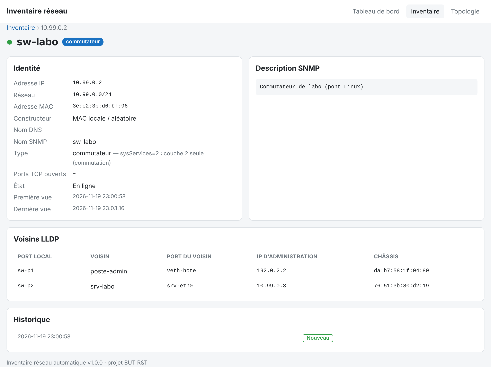

### 5.3 Scénarios de robustesse

Trois situations réelles ont été reproduites sur le labo.

**a) Un hôte qui bloque le ping** (comportement par défaut du pare-feu
Windows), simulé avec `icmp_echo_ignore_all=1`. Le ping échoue, mais
l'hôte est retrouvé grâce à ARP :

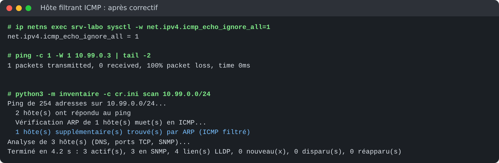

**b) Un hôte éteint** (interface coupée). Il est correctement déclaré
« disparu » :

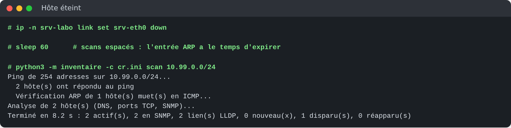

**c) Le même hôte rallumé** : il est déclaré « réapparu ».

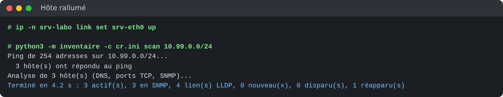

L'historique de l'équipement garde la trace des trois événements :

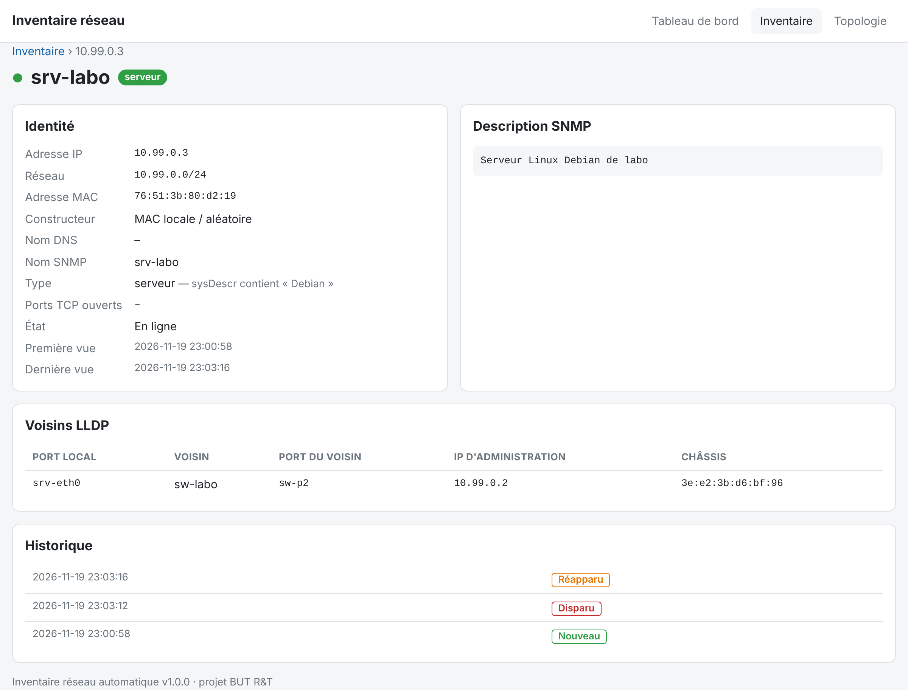

Et le tableau de bord les résume :

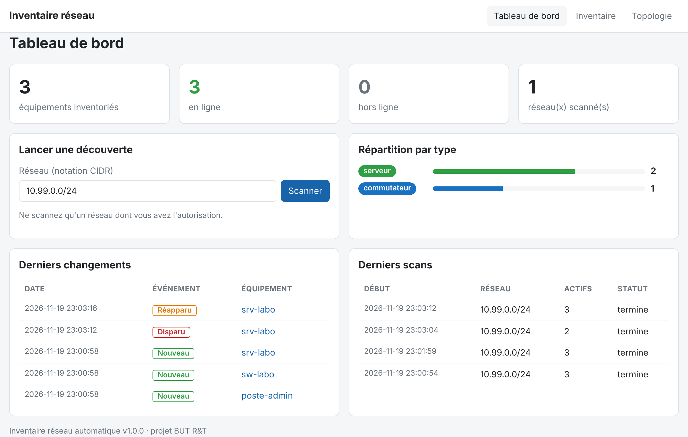

### 5.4 Scan lancé depuis l'interface

Le scan tourne en arrière-plan ; son journal s'affiche en direct dans le
tableau de bord :

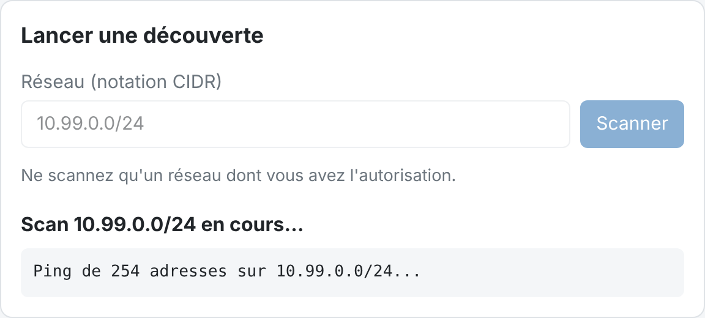

### 5.5 Sécurité : la communauté SNMP v2c circule en clair

La capture d'une requête SNMP v2c émise par l'outil montre la communauté
`public` en clair dans le paquet :

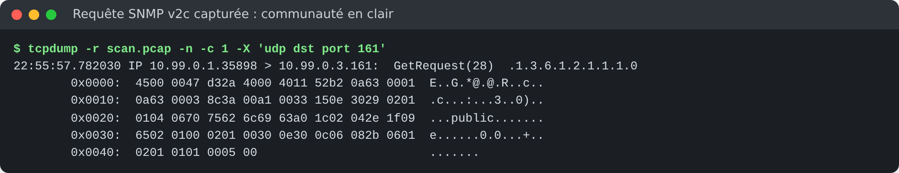

Lecture du message SNMP (codage ASN.1/BER), à partir de l'octet `0x1c` :
`30 29` (SEQUENCE de 41 octets), `02 01 01` (INTEGER version = 1, c'est-à-dire
**v2c**), `04 06 70 75 62 6c 69 63` (OCTET STRING de 6 octets : **« public »**).
N'importe qui capturant le trafic peut donc lire la communauté. C'est pour
cela que l'outil prend aussi en charge **SNMPv3 authPriv** (SHA + AES),
testé sur le labo :

| Test SNMPv3 (utilisateur `inventaire`, SHA/AES) | Résultat |
|---|---|
| Bons mots de passe | identité et voisins LLDP lus |
| Mauvais mot de passe d'authentification | refusé, sans plantage (équipement noté « sans SNMP ») |
| Mots de passe placés dans `~/.snmp/snmp.conf` (hors de la ligne de commande) | identité lue |

### 5.6 Mode démonstration

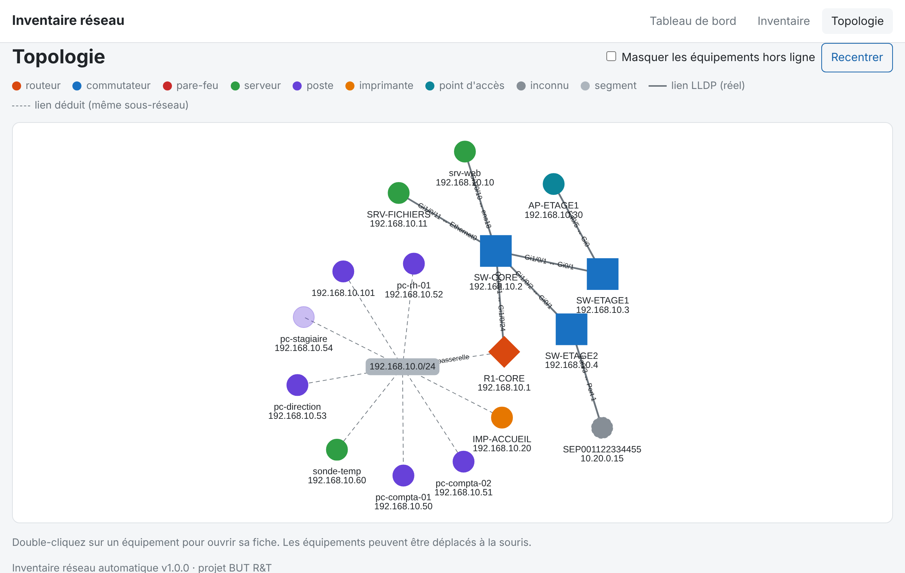

On y voit les trois sortes de liens : LLDP réels (trait plein, avec
ports), déduits (pointillés, postes rattachés au segment
`192.168.10.0/24`) et un voisin hors inventaire (téléphone IP du VLAN
voix, contour pointillé).

### 5.7 Synthèse

| Critère | Objectif | Mesuré | |
|---|---|---|---|
| Hôtes actifs trouvés (labo) | 3 / 3 | 3 / 3 | ✅ |
| Hôte filtrant ICMP trouvé | oui | oui (via ARP) | ✅ |
| Hôte éteint détecté | oui | oui (« disparu ») | ✅ |
| Liens LLDP (labo) | 2 | 2 (4 déclarations fusionnées) | ✅ |
| Types attendus (labo + démo) | – | 17 / 18 (voir ci-dessous) | ⚠️ |
| Durée d'un scan /24 | < 60 s | 4,2 s (8,2 s avec vérification ARP) | ✅ |
| Tests unitaires | tous verts | 63 / 63 | ✅ |
| Interface sans Internet | oui | aucune requête externe | ✅ |
| SNMPv3 authPriv | oui | oui (snmpd) | ✅ |
| Équipements Cisco réels (GNS3) | – | non testé | ⏳ à faire |

Sur les 18 équipements classés, un seul ne correspond pas au type
attendu : **poste-admin**, poste de travail Linux sur lequel tourne snmpd,
est classé « serveur » (« répond en SNMP sans indice plus précis »). Rien
ne distingue en effet, côté réseau, un poste Linux d'un serveur Linux :
c'est une limite de l'approche heuristique, signalée par la raison
affichée. La sonde Raspberry Pi (SSH ouvert) classée « serveur » et le
smartphone classé « poste » (catégorie générique des terminaux)
correspondent au comportement prévu.

---

## 6. Difficultés rencontrées et solutions

### 6.1 Le cache ARP garde des hôtes éteints

**Symptôme.** Un hôte dont l'interface avait été coupée était toujours
compté comme actif, « trouvé par ARP ».

**Cause.** Le cache ARP conserve les entrées d'hôtes qui ne répondent plus
(état `STALE`). Lire seulement « l'adresse est dans la table » ne suffit
pas.

**Solution.** Lire l'**état** de chaque entrée, géré par le noyau selon la
machine d'états *NUD* (*Neighbour Unreachability Detection*), et ne
retenir un hôte muet en ICMP que si son entrée passe à `REACHABLE`
(réponse ARP fraîche) :

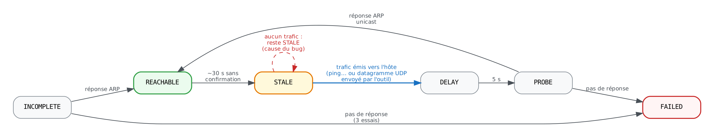

### 6.2 Un bug intermittent trouvé pendant ce compte rendu

**Symptôme.** En refaisant les scénarios pour les captures de ce compte
rendu, l'hôte qui bloque le ping a été déclaré « disparu » alors qu'il
fonctionnait, et le scan a duré 14 s au lieu de 4 :

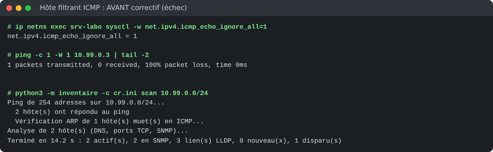

**Analyse.** J'ai relevé l'état de l'entrée ARP seconde par seconde après
un ping :

```
t+5s  10.99.0.3 dev veth-hote lladdr 76:51:3b:80:d2:19 REACHABLE
t+6s  10.99.0.3 dev veth-hote lladdr 76:51:3b:80:d2:19 STALE
t+12s 10.99.0.3 dev veth-hote lladdr 76:51:3b:80:d2:19 STALE
```

Une entrée `STALE` **n'évolue que si du trafic est émis** vers l'hôte. Le
ping est parti quand l'entrée était encore `REACHABLE` (aucune
revérification), puis elle a expiré pendant le balayage et, plus aucun
paquet ne partant vers cet hôte, elle est restée `STALE` indéfiniment.
L'outil a attendu 10 s puis abandonné. Le bug dépendait donc du
**moment** du scan, d'où son caractère intermittent.

**Solution.** Tant qu'une entrée est `STALE`, l'outil envoie à l'hôte un
datagramme UDP vide (port 9, *discard*). Ce paquet sans conséquence force
le noyau à revérifier l'entrée (flèche bleue du schéma ci-dessus).
Validation en forçant l'état `STALE` à la main
(`ip neigh replace … nud stale`) : hôte actif confirmé en 6,0 s, hôte
éteint écarté en 9,0 s. Un test unitaire a été ajouté pour ce cas.

### 6.3 Limite : un hôte éteint juste après un scan

Si un hôte est coupé **moins de ~30 s** après le dernier échange avec lui,
son entrée ARP est encore `REACHABLE` et le noyau ne la revérifie pas :
l'hôte est encore compté actif.

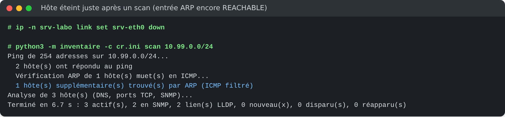

Sans droits root, on ne peut pas forcer une nouvelle requête ARP sur une
entrée que le noyau juge valide. En usage normal (scans espacés de
plusieurs minutes), l'entrée a expiré au scan suivant et l'hôte est bien
détecté comme disparu (§ 5.3 b). Cette limite est documentée plutôt que
contournée, pour garder l'outil simple.

### 6.4 Windows classé comme routeur

**Symptôme.** Dans le jeu de démonstration, le serveur de fichiers Windows
apparaissait comme « routeur ».

**Cause.** Windows annonce `sysServices = 76`, avec le bit « couche 3 »
positionné, car il implémente IP.

**Solution.** N'utiliser `sysServices` que si le bit « couche 2 » est
aussi présent (vrai pour les routeurs et commutateurs Cisco : 78, 6, 2).
Les autres équipements passent aux règles suivantes.

### 6.5 Le voisin LLDP n'annonce pas l'adresse attendue

**Symptôme.** Le commutateur du labo déclarait un voisin `poste-admin`
d'adresse `192.0.2.2`, une adresse absente de l'inventaire (scan de
`10.99.0.0/24`). Le lien n'était pas tracé.

**Cause.** LLDP annonce *une* adresse d'administration de l'équipement,
pas forcément celle du réseau scanné (ici l'adresse de l'interface
`eth0` de la machine).

**Solution.** Rechercher le voisin par IP, **puis par MAC de châssis,
puis par nom**. Un voisin introuvable est affiché comme nœud « hors
inventaire » plutôt que perdu.

### 6.6 Mise au point du labo LLDP

- **lldpd n'émettait aucune trame** (`Transmitted: 0` dans
  `lldpcli show statistics`). En mode débogage (`lldpd -d -ddd`), on
  voit qu'il démarre **en pause** en attendant sa configuration. Solution
  : `lldpcli resume`.
- **Noms provisoires et voisin manquant** au premier scan : les trois
  agents démarrant l'un après l'autre, les premières trames partent avant
  que tout le monde écoute. Solution : forcer un renvoi
  (`lldpcli update`) une fois les trois agents démarrés.
- **Accès refusé au socket de contrôle de lldpd** dans le dossier
  temporaire : sockets placés dans `/run/inventaire-labo`.

### 6.7 Formats de sortie de Net-SNMP

Les sorties réelles ont révélé plusieurs pièges, tous gérés et testés :

| Constat | Exemple |
|---|---|
| Les chaînes sont entre guillemets | `"sw-labo"` |
| Les MAC sont en hexadécimal avec un espace final | `"C6 00 EF A5 29 B7 "` |
| Un OID absent renvoie un code de retour **0** | `No Such Instance currently exists at this OID` |
| Une valeur peut tenir sur plusieurs lignes | `sysDescr` des équipements Cisco |
| L'IP d'un voisin LLDP est **dans l'OID**, pas dans la valeur | `…4.2.1.3.10400.6.1.1.4.10.99.0.2` |

### 6.8 Autres difficultés

| Difficulté | Solution |
|---|---|
| Bibliothèques SNMP Python à l'API instable | utiliser les commandes Net-SNMP |
| SQLite refuse qu'une connexion soit partagée entre threads (scan en arrière-plan) | une connexion par requête web et par scan |
| Noms DNS longs illisibles sur le graphe | affichage du nom court |
| Chromium refuse d'ouvrir `http://127.0.0.1:5060` (`ERR_UNSAFE_PORT`) | 5060 est le port de **SIP** : les navigateurs bloquent les ports de services connus. Port changé |

---

## 7. Bilan

### 7.1 Ce qui fonctionne

- Découverte d'un /24 en quelques secondes, **sans droits root**, y
  compris des hôtes qui filtrent le ping.
- Identification : MAC, constructeur, nom, services, description SNMP.
- Classification justifiée de chaque équipement.
- Topologie physique réelle grâce à LLDP, avec repli sur le sous-réseau
  pour les équipements sans LLDP.
- Historique et détection des changements.
- Interface web complète, utilisable hors ligne ; exports CSV et JSON.
- SNMP v2c et v3 ; 63 tests automatisés ; labo reproductible.

### 7.2 Limites

- ARP ne traverse pas les routeurs : pas de MAC pour les réseaux distants.
- Les postes sans LLDP sont rattachés au sous-réseau, pas à leur port de
  commutateur.
- La clé d'un équipement est son IP : avec du DHCP, un appareil qui change
  d'adresse apparaît comme nouveau.
- La détection d'un hôte éteint peut être retardée d'un scan si le scan
  précédent date de moins de ~30 s (§ 6.3).
- Classification heuristique : un poste Linux qui répond en SNMP est vu
  comme un serveur.
- Pas encore testé sur de vrais équipements Cisco.

### 7.3 Perspectives

1. Valider sur une maquette GNS3 (IOSv / IOSvL2) puis en salle de TP.
2. Lire la **table MAC des commutateurs** (BRIDGE-MIB) pour rattacher
   chaque poste à son port.
3. Lire **CDP** pour les réseaux Cisco et la table ARP des routeurs
   (`ipNetToMediaTable`) pour les réseaux distants.
4. Alertes lors de l'apparition d'un équipement inconnu.

### 7.4 Compétences mobilisées

| Domaine | Mise en œuvre |
|---|---|
| Réseau | ICMP, ARP et machine d'états NUD, LLDP, SNMP v2c/v3 (MIB, OID, ASN.1), namespaces et veth Linux, analyse de trames avec tcpdump |
| Programmation | Python (modules, threads, `subprocess`), SQL, Flask, JavaScript |
| Méthode | tests automatisés, labo reproductible, diagnostic d'un bug intermittent, versionnage Git |
| Sécurité | lecture seule, SNMPv3, risques de SNMP v2c, cadre légal du scan |

---

## 8. Annexe (reproduire les tests)

```bash
sudo apt install -y iproute2 snmp snmpd lldpd tcpdump
pip install -r requirements-dev.txt

python -m pytest -v                                   # § 5.1
sudo scripts/labo_veth.sh start                       # § 4.2
python -m inventaire scan 10.99.0.0/24                # § 5.2
python -m inventaire web                              # http://127.0.0.1:5000

# § 5.3 a) hôte qui bloque le ping
sudo ip netns exec srv-labo sysctl -w net.ipv4.icmp_echo_ignore_all=1
python -m inventaire scan 10.99.0.0/24
sudo ip netns exec srv-labo sysctl -w net.ipv4.icmp_echo_ignore_all=0

# § 5.3 b) et c) hôte éteint puis rallumé (attendre ~1 min entre les scans)
sudo ip -n srv-labo link set srv-eth0 down
python -m inventaire scan 10.99.0.0/24
sudo ip -n srv-labo link set srv-eth0 up
python -m inventaire scan 10.99.0.0/24

# § 2.3 et 5.5 : capture des trames LLDP et SNMP
sudo tcpdump -i veth-hote -w scan.pcap 'ether proto 0x88cc or udp port 161'

sudo scripts/labo_veth.sh stop
```

Les schémas de ce compte rendu sont générés avec Graphviz à partir des
fichiers `docs/compte-rendu/schemas/*.dot` (commande
`dot -Tpng -Gdpi=170 fichier.dot -o fichier.png`).
